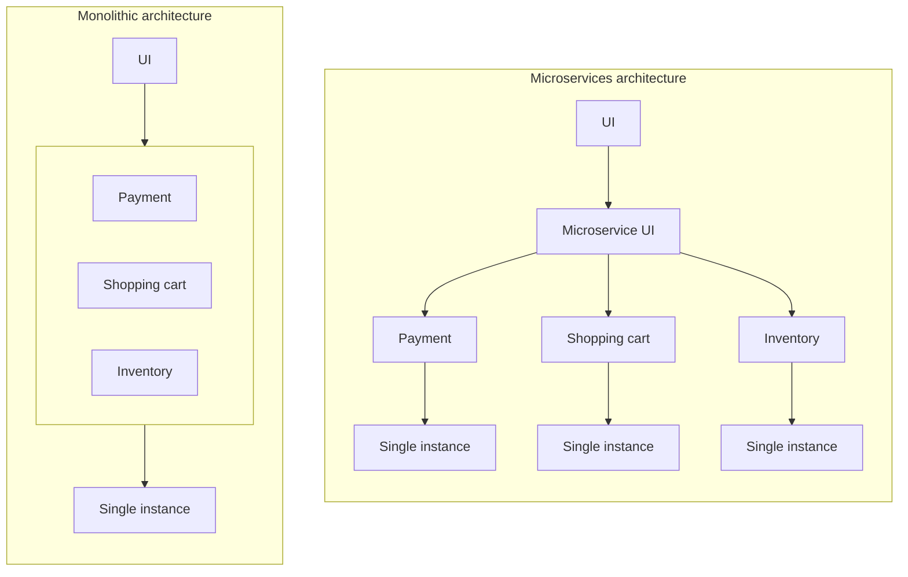
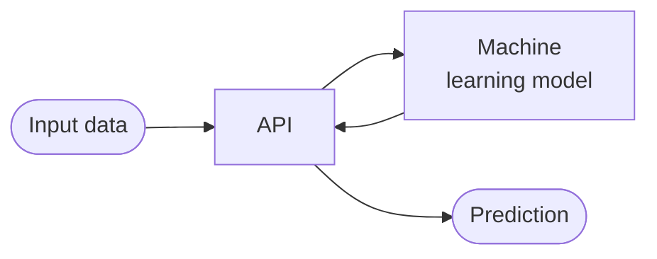
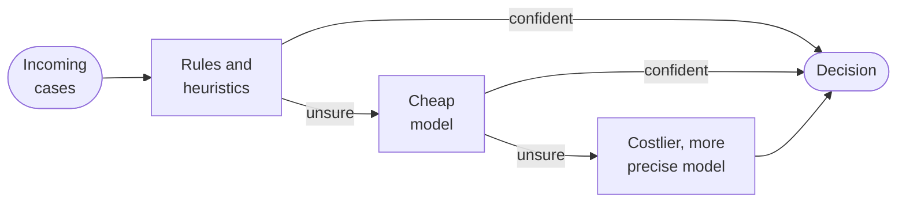

# 4.2 Deployment Architecture

## 4.2.1 Runtime Environment

A runtime environment refers to the specific configuration of software and hardware where an application, particularly a machine learning model, executes. It encompasses the operating system, libraries, dependencies, and execution engine necessary for the application to function correctly.

### Containerization

Containerization is a lightweight, portable, and self-sufficient software package that bundles an application and all its dependencies (libraries, configuration files, and other required assets) into a single, isolated unit.

There are many benefits of containerization:

  - **Easier to Maintain:**

      - **Dependency Management:** Containers encapsulate all dependencies, eliminating "it works on my machine" problems. This simplifies debugging and ensures consistent behavior.
      - **Version Control:** You can version control container images, making it easy to roll back to previous stable versions if issues arise.
      - **Resource Isolation:** Containers provide process and resource isolation, preventing conflicts between different applications running on the same host.
  - **Portable:**

      - **"Build Once, Run Anywhere":** A container image built on one machine can run identically on any other machine that has a container runtime (like Docker or containerd). This applies across development, testing, staging, and production environments, regardless of the underlying infrastructure (on-premises, cloud, hybrid).
      - **Cloud Agnostic:** Facilitates deployment to various cloud providers (AWS, Azure, GCP, etc.) without significant reconfigurations.
  - **Fast to Start Up:**

      - **Lightweight:** Unlike virtual machines, containers share the host OS kernel, making them much lighter and faster to boot. They only contain the application and its specific dependencies, not an entire operating system.
      - **Efficient Resource Utilization:** Their lightweight nature means they consume fewer resources (CPU, RAM) compared to VMs, allowing for higher density of applications on the same hardware.

**Key Technologies:**

  - **Docker:** The most popular platform for building, sharing, and running containers.
  - **Kubernetes (K8s):** An open-source system for automating deployment, scaling, and management of containerized applications. It orchestrates containers across a cluster of machines.

## 4.2.2 Microservices Architecture

**Microservices architecture** is an architectural style that structures an application as a collection of loosely coupled, independently deployable services. Each service represents a specific business capability and can be developed, deployed, and scaled independently.



*Monolithic vs. microservices architecture: in a monolith every service runs on one shared instance; with microservices each service runs on its own instance.*

### Inferencing

**Inferencing (or Prediction)** is the process in which we send new, unseen input data to a trained machine learning model and receive an output or prediction from the model. This is the "production" phase where the model's learned patterns are applied to solve real-world problems.

  - **Input Data:** Can be diverse, e.g., an image for an object detection model, text for a sentiment analysis model, or tabular data for a fraud detection model.
  - **Model Execution:** The trained model's internal logic and parameters are applied to the input data.
  - **Output:** The model generates a prediction, classification, regression value, or other relevant output based on its training.

**Example:**

  - Sending an image of a cat to a trained image classification model and receiving "cat" as the output.
  - Inputting customer demographics to a churn prediction model to get a probability of churn.

### APIs

An API (Application Programming Interface) is a set of rules and protocols that allows different software applications to communicate and interact with each other. In the context of machine learning in production, APIs are crucial for exposing trained models so that other applications or services can consume their predictions.



*The API sits between the client and the model: it receives the input data, passes it to the model and returns the prediction.*

For a churn model, the request body carries one record per customer and the response returns one probability per customer (first record shown):

```json
[{"id": 189283, "customer_sex": "male", "bought_last_item": 182,
  "items_bought": 22, "total_charges": 979, "newsletter": 1}]
```

```json
[{"id": 189283, "churn_probability": 0.98}]
```

**Key Aspects of APIs for ML Models:**

  - **Standardized Access:** APIs provide a defined contract (endpoints, request/response formats, authentication) for interacting with the model, abstracting away the underlying complexity of the model's implementation.
  - **Integration:** They enable seamless integration of ML models into existing applications, websites, mobile apps, or other backend systems.
  - **RESTful APIs (Representational State Transfer):** The most common type of web API for ML model serving. They use standard HTTP methods (GET, POST, PUT, DELETE) to perform operations.

      - For ML inferencing, a common pattern is to use a POST request to send input data to an endpoint and receive the prediction in the response body (often JSON format).
  - **RPC (Remote Procedure Call):** Another API style where a client executes a function or procedure in a different address space (e.g., on a server) as if it were a local call. gRPC is a popular RPC framework often used for high-performance ML inference.
  - **API Gateway:** Often used in production to manage, secure, and monitor API calls to various microservices, including ML models. It can handle authentication, rate limiting, logging, and routing.

By using APIs, data scientists can focus on building and training models, while software engineers can easily integrate these models into user-facing applications without needing deep knowledge of the ML model's internal workings.

## 4.2.3 Serving Patterns

Several patterns from general system design come up again and again when models are served in production.

### Cascade

A **cascade** splits a problem into stages that run in sequence, each handling a smaller or harder subset of the cases. Cheap stages (rate limits, rules, heuristics, small models) go first and settle what they can with confidence; only the remaining cases reach the costlier, more precise models downstream. The system as a whole does less work, and separate teams can own separate stages. The risk is coupling: a downstream model can come to rely on the upstream stages behaving exactly as they do today. *(Yan, [More Design Patterns for ML Systems](https://eugeneyan.com/writing/more-patterns/))*



*A cascade: each stage settles the cases it is confident about and passes the rest on, so the costliest model sees the fewest cases. Adapted from Eugene Yan, [More Design Patterns For Machine Learning Systems](https://eugeneyan.com/writing/more-patterns/).*

Recommender systems are the classic case: retrieval cuts millions of items down to hundreds of candidates quickly and coarsely, optimizing for recall and speed, and ranking then scores only those candidates, slowly and precisely. *(Yan, [More Design Patterns for ML Systems](https://eugeneyan.com/writing/more-patterns/))*

Spam, bot and abuse detection follow the same shape *(Yan, [Content Moderation & Fraud Detection](https://eugeneyan.com/writing/content-moderation/))*:

  - **Stack Exchange** fights spam in three layers. Accounts that post faster than any person could get an HTTP 429 (Too Many Requests) and are blocked or rate-limited. Posts then go through a large set of regular expressions and rules; matches are shown to users, and six user flags mark a post as spam. Last, an automated system picks out the posts most likely to be spam; once shadow testing showed it was highly accurate, it was allowed to cast three flags on its own, which sharply cut the time until spam was deleted.
  - **Cloudflare** runs heuristics before its bot-detection models: hundreds of heuristics take about 20 ms, against about 50 ms for one model inference. The heuristics classify 15% of all traffic (30% for bot-management customers) with the lowest false positive rate of any of its detection methods, so the models only see what is left.
  - **LinkedIn** chains three models to detect harassment in messages, scoring the sender, then the message, then the whole conversation. Each model runs only if the one before it flags the exchange, so fewer accounts and messages get analyzed, which also protects privacy.

### Cache Proxy

A **cache proxy** stands in front of the model and answers repeat requests from a cache; only misses go through to real-time inference. It pays off when a few inputs make up most of the traffic, as in search, where a small share of queries accounts for most requests. Caching the results for the top queries (query suggestions, query classification, retrieval and ranking) saves much of the inference compute. *(Yan, [Design Patterns in ML Code and Systems](https://eugeneyan.com/writing/design-patterns/))*

### Reverse Proxy

To scale a model horizontally, run it on several servers behind a **reverse proxy**: clients call one address, and the proxy spreads requests across the servers to share the load and keep latency low. A plain **load balancer** only does the spreading; a reverse proxy usually also caches responses, shields the servers from direct internet access, and terminates SSL. *(Yan, [Design Patterns in ML Code and Systems](https://eugeneyan.com/writing/design-patterns/))*

### Mediator

A **mediator** sits between services so they never call each other directly, which keeps them loosely coupled. If your systems already have one, expect to serve models through it rather than straight to the applications that use them, and to follow its request schemas and its limits on latency and request rates. For example, recommendation widgets on a home page can go through a mediator that ranks the widgets, drops any with too few items, and removes items repeated across widgets. *(Yan, [Design Patterns in ML Code and Systems](https://eugeneyan.com/writing/design-patterns/))*
