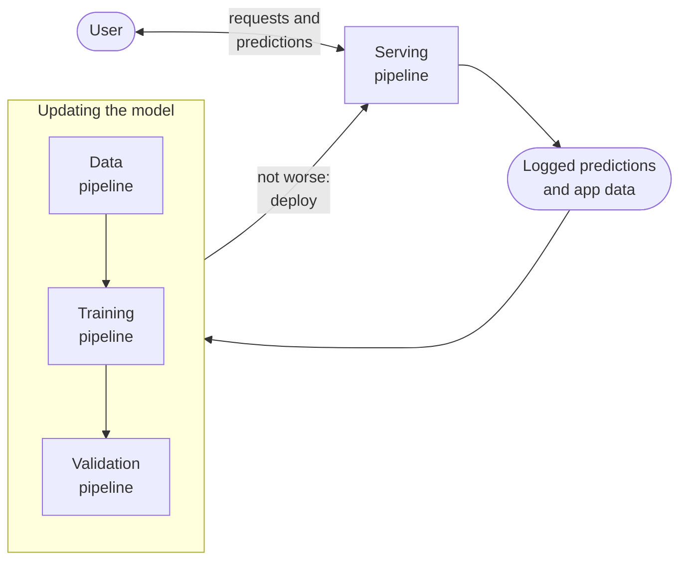
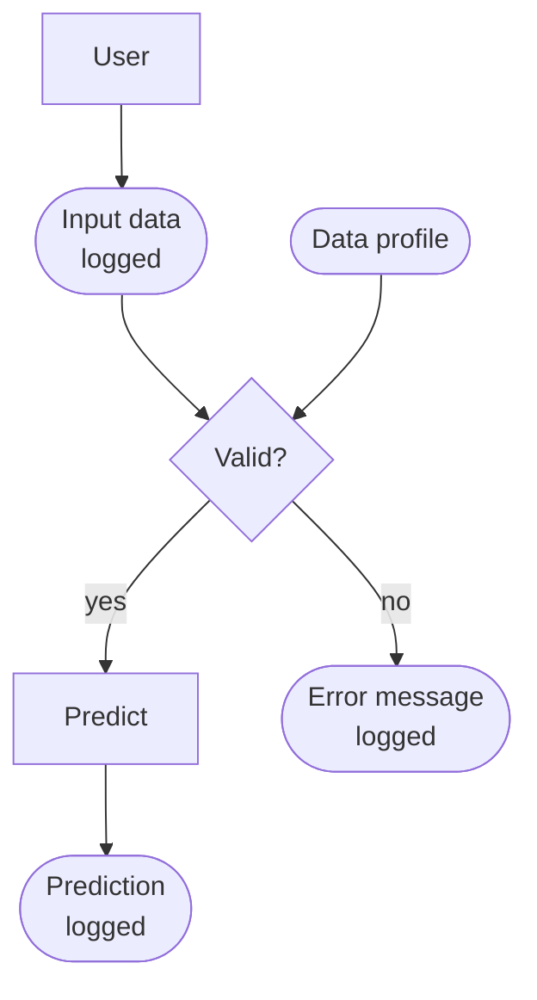
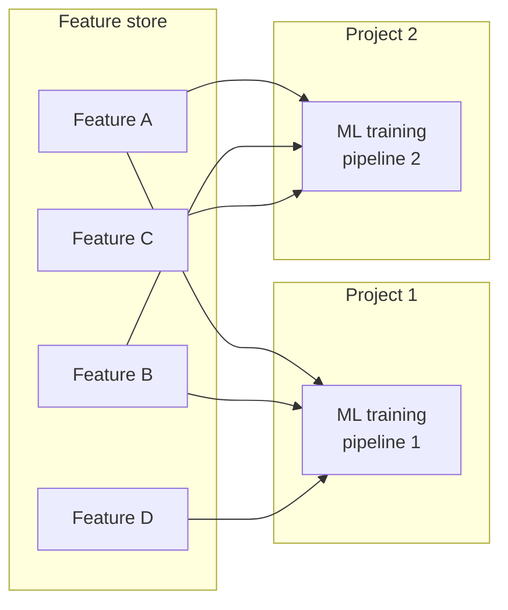
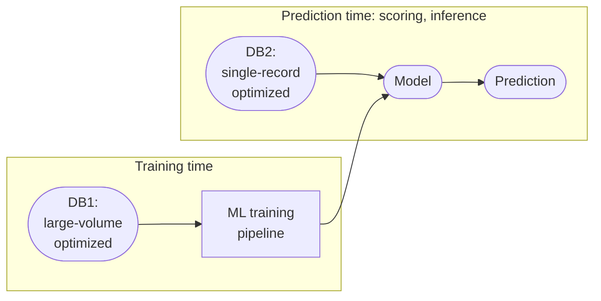
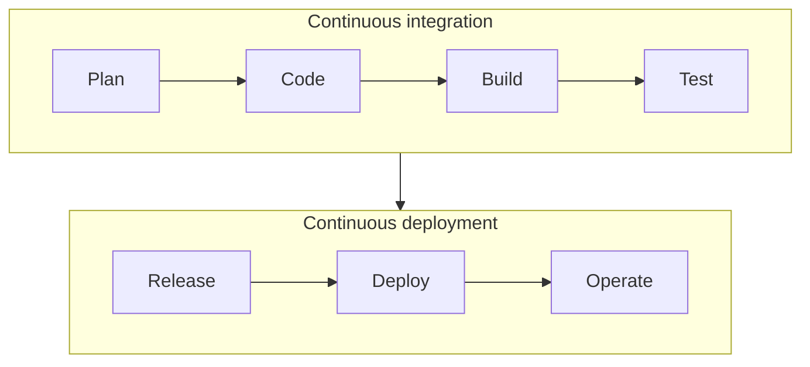
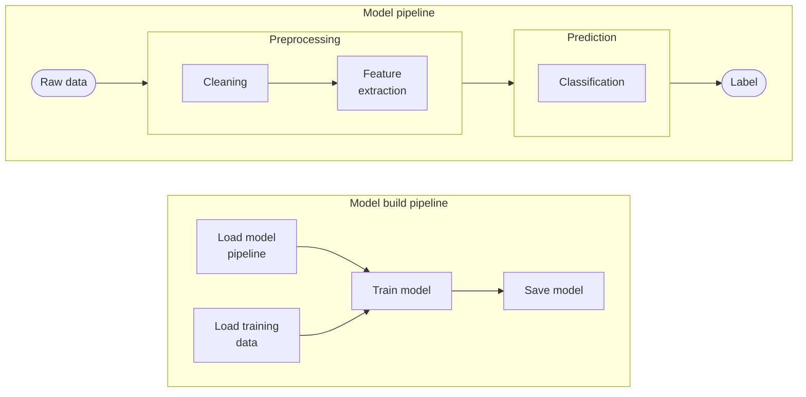
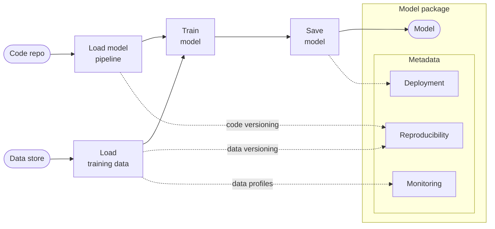
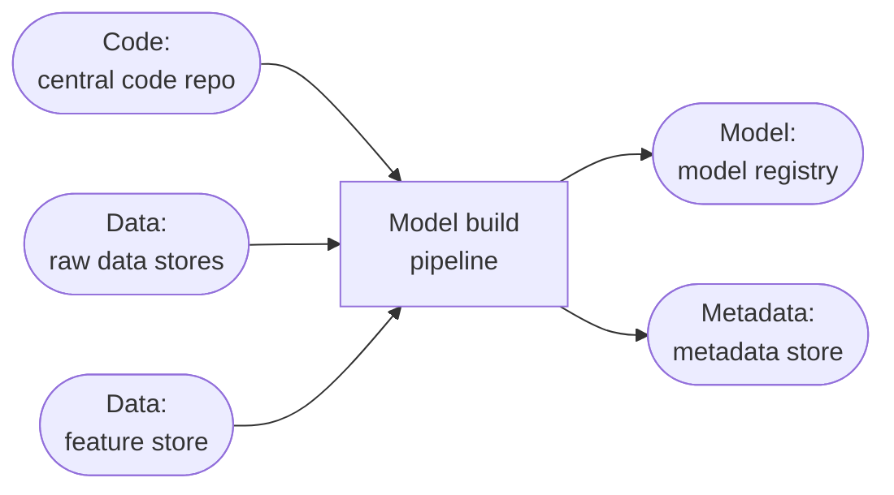

# 4.4 Reproducibility and CI/CD

A model that works in a notebook still has to be rebuilt, validated, and shipped the same way every time. This section covers what makes that possible: the pipelines that keep a fresh model in production, tracking where a model came from, validating its data, versioning everything, and automating the build.

## 4.4.1 Pipelines, Not Models

In production the goal isn't to build one model and deploy it, but to build automated pipelines that keep training, validating, and deploying new ones. The world changes, the data shifts, and a model starts going stale as soon as it is deployed; replacing it by hand (collect and process new data, train, validate, deploy) is slow and error-prone. Each pipeline either delivers predictions or updates the model *(Managing ML Projects, [ML Pipelines](https://developers.google.com/machine-learning/managing-ml-projects/pipelines))*:

| Pipeline | Takes | Produces |
|---|---|---|
| Serving | User requests | Predictions, either online (computed per request) or offline (precomputed and looked up), usually post-processed before delivery, e.g., to filter or rerank results |
| Data | Application logs | Fresh training and test datasets, with the same features and label as the original |
| Training | The new training dataset | A candidate model |
| Validation | The candidate, the production model, and the new test dataset | A decision: deploy the candidate if it isn't meaningfully worse than the production model, and raise an alert if it is |

*The four pipelines of a production ML system. Adapted from Google for Developers, Managing ML Projects.*

*Once a model is live, the data pipeline builds new datasets from the logs; on a schedule or a trigger, the training and validation pipelines produce a candidate, which replaces the production model if it isn't worse. Adapted from Google for Developers, Managing ML Projects.*

**Train before the model goes stale.** How fast that happens depends on the data: a clothing recommender goes stale quickly because tastes change, while a flower classifier may never need it. Retraining early leaves a buffer for a failed pipeline run or a poor candidate. Google's default is to train and deploy daily, like a daily software build; [4.5.4](monitoring.md#454-iterative-monitoring-process) covers how to choose a frequency. *(Managing ML Projects, [ML Pipelines](https://developers.google.com/machine-learning/managing-ml-projects/pipelines))*

**Log predictions, and the ground truth when you can get it.** Aggregated predictions show when the model starts to lose quality: on average, a model's predictions should match the average label in its training data, and a gap between the two is called **prediction bias**. Ground truth can arrive late (a six-week weather forecast can only be checked after six weeks), so build feedback into the product where you can, and know its limits: users who leave spam unopened in the inbox label it "not spam". *(Managing ML Projects, [ML Pipelines](https://developers.google.com/machine-learning/managing-ml-projects/pipelines))*

**Version datasets and models, and document them.** Versioned datasets give reproducibility, audit trails for compliance, retention rules, access control, a history of changes for debugging, and discoverability for other teams (see [4.4.3](#443-profiling-versioning-and-feature-stores)). A model registry adds a release process: review, approve, release, or roll back a model, and trace its datasets and dependencies. Describe a dataset in the design doc, or in a **data card** if you share it, and a model's purpose, architecture, hardware needs, and metrics in a **model card**. *(Managing ML Projects, [ML Pipelines](https://developers.google.com/machine-learning/managing-ml-projects/pipelines))*

**Check during development what could block the pipeline.** A problem found only when the pipeline is built sends you back to experimentation *(Managing ML Projects, [ML Pipelines](https://developers.google.com/machine-learning/managing-ml-projects/pipelines), [Productionization](https://developers.google.com/machine-learning/managing-ml-projects/production))*:

  - **Data access**: you may have to justify why you need the data and how personal information will be handled; a proof of concept that shows the gain helps.
  - **Features in production**: some features used in experiments aren't available in real-time data.
  - **How the data was collected**: learning who collected it and how takes time, and a production model shouldn't train on data you don't trust.
  - **Effort and cost against quality**: a feature can be costly to add to the pipeline, or to obtain and store, for a small gain.
  - **Compute**: estimate quota for the data and training pipelines from similar projects, and for serving from the expected queries per second, then add what ongoing experiments need. Training usually needs bigger hardware than serving.
  - **Golden datasets**: when the data changes often, keeping consistent, accurate labels for a golden set is hard.

## 4.4.2 Transparency and Reproducibility

A model handed over for deployment raises questions the person who trained it may not have answered: will it run on the production infrastructure, can anyone see how it was built, can it be reproduced, are its inputs validated, and how will it be monitored and debugged? Answering these early is cheaper than answering them at deployment time.

Each model should carry a record of where it came from: who trained it and when, the code version, the data version, and the parameters used to train it. That record makes the model auditable and lets you reproduce a result or trace a problem back to its cause.

Logging experiments in a metadata store (see [3.9 Experiment Tracking](../development/experiment-tracking.md)) gives you that record as a side effect.

Common concerns when putting a model in production:

  - Input data validation - data profiles (aka data expectations)
  - Performance deterioration. Minimum requirement: log inputs and outputs.
  - Debugging: log input data, error messages and predictions, using purpose-built tools rather than improvised ones.
  - Testing: am I comfortable making changes to this code?

      - Unit tests
      - Integration tests
      - Load tests
      - Stress tests
      - Deployment tests

*Input data validation at prediction time; the prediction or the error message goes back to the user. The data profile is created in the model build pipeline and saved with the metadata. Logging the input data, error messages and predictions is what makes the service debuggable.*

## 4.4.3 Profiling, Versioning, and Feature Stores

### Data Profiling

Automated data analysis and creation of high-level summaries (a.k.a. data profiles, expectations), used for validating and monitoring data in production.

Creating the data profile is one step in an ML pipeline checklist:

  - Is the code versioned?
  - Is the data versioned?
  - Train the model.
  - Save the model.
  - Create a data profile.
  - Record the exact version of the training data (data versioning, for reproducibility).

Risks of **not** using data profiles:

  - Clients complaining, although they submitted erroneous inputs to the model
  - No way to identify that data has drifted and our model is no longer valid

A training pipeline reads raw data from a **data store** and the model definition from a **code repository**, trains the model, and stores it in a **model registry**. It should also write to a **metadata store**: the dataset version, the train/test split, and a fingerprint of the data, so the exact build can be recreated.

A popular tool for data profiling is Great Expectations.

### Versioning

Versioning in machine learning engineering is the practice of systematically tracking and managing changes to all components of an ML project, including code, data, models, and hyperparameters, over time. Unlike traditional software development where Git excels at versioning code, ML projects involve large datasets and model artifacts that Git cannot efficiently handle.

Tools like DVC (Data Version Control) extend Git's capabilities by providing a lightweight mechanism to version large files and directories by storing their metadata (like checksums) in Git, while the actual data resides in external storage (e.g., cloud storage, local drives). This allows teams to precisely reproduce past experiments, revert to previous states, track data lineage, and ensure that a specific model was trained with an exact version of data and code, which is crucial for collaboration, debugging, and maintaining reliable production systems.

### Feature Stores

A feature store in machine learning engineering is a centralized repository that standardizes the management, storage, and serving of features for both model training and real-time inference. It acts as a bridge between data engineering and data science, allowing for the consistent definition, computation, and reuse of features across different models and teams, thereby preventing training-serving skew (where features used for training differ from those used in production; see [4.5.8](monitoring.md#458-training-serving-skew)). Typically, a feature store includes an offline store for historical, large-volume data used in training and an online store optimized for low-latency, single-record retrieval during live predictions, significantly streamlining the MLOps lifecycle by improving efficiency, reproducibility, and model reliability.

*Features defined once in the feature store (essentially a database) are reused by the training pipelines of different projects.*

Training and serving read data in different ways. Training scans large volumes in batch, so it needs storage optimized for throughput (the **offline store**). Serving fetches the features of one record at a time with low latency (the **online store**). A feature store provides both, computed from the same definitions.

*A feature store as a dual database: DB1 (the offline store) feeds training, DB2 (the online store) feeds the model at prediction time.*

Its main benefits are reusability (features are built once and shared across models) and consistency (training and serving use the same feature values, so a model trained on emails as plain text is not served the same emails as raw HTML).

### Feature Store Hierarchy of Needs

What a feature store has to do depends on what the team needs, and those needs stack like a pyramid: the lower levels have to be in place before the higher ones are worth attention *(Yan, [Feature Stores: A Hierarchy of Needs](https://eugeneyan.com/writing/feature-stores/))*.

| Level | Need | What it covers |
|---|---|---|
| 1 | Access | Finding and reusing features: seeing the code behind each one (transparency) and tracing it back to its upstream sources (lineage), so teams stop building their own versions of the same feature |
| 2 | Serving | Getting features to models in production with low latency and high throughput, usually by syncing the offline store into the online one |
| 3 | Integrity | Consistent features in training and serving (no training-serving skew), and historical features that are point-in-time correct, so training and evaluation never see values from the future |
| 4 | Convenience | Simple APIs that look the same for training and serving, and interactive tools that speed up development and debugging |
| 5 | Autopilot | Automating tedious work such as backfilling new features and monitoring feature distributions with alerts |

Not every team needs every level. Most get the bulk of the value from access, serving, and the skew-prevention part of integrity; convenience and autopilot become worth building early mainly for large companies running their own feature store. How much each level demands also varies: a team with a few online use cases needs far less serving capacity than DoorDash, whose store handles millions of requests per second, and features that update during the day make point-in-time correctness harder. Integrity also needs monitoring: when each feature was last updated, whether schemas and distributions still hold, and whether serving meets its latency and throughput targets. *(Yan, [Feature Stores: A Hierarchy of Needs](https://eugeneyan.com/writing/feature-stores/))*

Start lean. With three components and three people, each person can own one component, learn it in depth and still cover for a colleague; double the components and nobody knows their part well, with no one left to cover. Monzo had features in its analytics warehouse that its production stack couldn't reach, so rather than build real-time feature processing, it copied the feature tables into its production store on a schedule. Anything more would have been operational load that slowed a small team down. *(Yan, [The Metagame of Applying ML](https://eugeneyan.com/writing/machine-learning-metagame/))*

## 4.4.4 CI/CD

*Continuous integration takes a change from plan to tested build; continuous deployment takes the tested build through release, deployment and operation. In the usual figure the two form linked loops that meet at testing.*

### Model Build Pipeline

Two pipelines are worth keeping apart: the **model pipeline** defines what the model does with an input, and the **model build pipeline** defines how the model is created and saved. The build pipeline is the one that runs in CI/CD.

*The model pipeline turns raw data into a label; the model build pipeline loads that pipeline and the training data, trains the model and saves it.*

The build pipeline loads the model definition from version-controlled code and the training data from a versioned data store, checked against data profiles. Its output is a **model package**: the trained model plus the metadata needed for deployment, reproducibility, and monitoring.

*The build pipeline's output is a model package: the trained model plus metadata for deployment, reproducibility (code and data versions) and monitoring (data profiles).*

At its simplest, the build pipeline loads the model definition, loads the training data, trains the model, and saves it. Running it inside CI/CD is what makes deployment automatic and results reproducible.

Its inputs are code from the repository, raw data from data stores, and engineered features from the feature store. Its outputs are the trained model, registered in a model registry, and the build metadata, stored in a metadata store.

*Inputs and outputs of the model build pipeline.*

### Testing and Pre-export Checks

Keep the learning part of the system encapsulated so everything around it can be tested on its own *(Rules of ML #5)*:

  - **Data into the algorithm**: Check that feature columns that should be populated are populated. Where privacy allows, inspect the training input by hand, and compare pipeline statistics against the same data processed elsewhere.
  - **Models out of the algorithm**: The model must give the same score in the training environment and in the serving environment.
  - **Code paths**: Test the code that creates examples in both training and serving, and make sure serving can load and use a fixed model.

Run sanity checks right before exporting a model, since a bad exported model is a user-facing problem. Check performance on held-out data (many continuously deploying teams gate on AUC), and don't export if you still have doubts about the data. A problem caught before export costs an email alert; a problem in a live model may cost a page. *(Rules of ML #9)*

### Testing Model Code

Software tests check logic that someone wrote; ML code also produces logic learned from data, and that needs tests of its own. Pre-train tests run without the trained model, while post-train tests and evaluation need it. The examples come from a Titanic survival model *(Yan, [How to Test ML Code and Systems](https://eugeneyan.com/writing/testing-ml/))*:

| Kind | What it checks | Examples |
|---|---|---|
| Pre-train tests | The implementation | One prediction per input row; probabilities between 0 and 1; no rows shared by train and test; a perfect fit on a tiny, separable dataset; training accuracy that rises as capacity (tree depth) grows |
| Post-train tests | The learned behavior | **Invariance**: changing a feature that shouldn't matter (a passenger's name or ticket number) leaves the prediction unchanged. **Directional expectation**: changing one that should matter moves it the expected way (a lower fare lowers predicted survival) |
| Evaluation | Performance | Metrics on held-out data above a floor; training time and serving latency under a limit at a high percentile (p95, p99), since consumers of the predictions may have strict latency requirements |

Pre-train tests are close to white-box testing, since they check the internals; post-train tests and evaluation are close to black-box testing, since they check outcomes.

Software unit tests usually mock dependencies such as databases, but in ML the logic sits inside the model, so some tests have to run the real one *(Yan, [Don't Mock ML Models in Unit Tests](https://eugeneyan.com/writing/unit-testing-ml/))*:

  - **Small inline samples**: Write the few rows a test needs into the test itself rather than loading a data file, so each test stands on its own. They suit custom splitting logic, custom distance functions, pre- and postprocessing, and empty or malformed input.
  - **Random or empty weights**: A model built from its configuration, without downloading trained weights, is enough to check output shapes and moving the model between devices.
  - **The real model for what matters most**: Check that the loss falls and the model can overfit a small sample, that outputs map to the right labels (two models can encode the same class with different indices), and that the model server starts and answers a batch request. Mark these tests as slow and run them at checkpoints such as before a merge.
  - **Not the libraries**: Assume data loaders, tokenizers and optimizers work.

### Testing Data Pipelines

Bigger test scopes give slower feedback: unit tests return results in milliseconds, but an A/B test can't report until the change is built and the experiment has run its course. Even fast offline tests can fail when the pipeline changes and the new code is correct. When Yan added a step to an example pipeline (count only the impressions a user could actually see, not every item the server sent), four of its six tests failed. Which ones failed follows a pattern *(Yan, [Robust Tests for Data & ML Pipelines](https://eugeneyan.com/writing/testing-pipelines/))*:

| Test | What it covers | After new data or logic |
|---|---|---|
| Row-level unit test | A function that turns one input into one value | Unchanged; add tests for the new functions |
| Schema test | The minimum set of columns and their types at key points | Unchanged; optionally cover the new columns |
| Column- or table-level unit test | A function that returns a column or a table | Expected output rebuilt by hand |
| Integration test | A fixed sample run through several steps | Expected output rebuilt by hand |

New data or logic only adds to the first two kinds but reaches back into the last two, which is why those can take longer to maintain than the feature code itself. They are still a safety net worth having, so write row-level and schema tests generously and keep a handful of the others. To make those sturdier:

  - **Assert coarse properties**: Row and column counts or the number of unique IDs, rather than exact values that tie the test to implementation details.
  - **Test at the smallest scope**: Thorough row-level tests reduce how much you rely on integration tests.
  - **Try property-based tests**: Generate many inputs from a specification (value ranges, valid categories), run them through the pipeline and check that the output keeps its expected properties. Yan isn't convinced they can check specific logic, such as the order of items before and after business rules.
  - **Question tests that keep changing**: A test is there to catch regressions; one that has to be rewritten often probably isn't doing that.

### Validating a Model Before Release

Yan's version of the pre-export check runs on every retraining and covers the model (its metrics) and the system around it (error rate, latency) *(Yan, [Maintaining ML in Production](https://eugeneyan.com/writing/practical-guide-to-maintaining-machine-learning/); Yan, [More Design Patterns for ML Systems](https://eugeneyan.com/writing/more-patterns/))*:

1.  **Hold out the most recent data**, such as the last seven days (more if the sample is small), and train on the rest. Split by time: a random split or cross-validation lets future data leak into training and makes the metrics look better than they are (see [3.2.4](../development/validation-and-tuning.md#324-choosing-a-splitting-strategy)).
2.  **Evaluate on the holdout** with the usual metrics (for a ranker: AUC, NDCG, recall@k) and against a **naive baseline**, such as ranking products by yesterday's sales or by popularity.
3.  **Compare with the current model's predictions.** If the current model ranks a product 10,000th and the new one ranks it first, investigate. The same check works for classification (change in probability) and regression (change in the predicted value).
4.  **Fail the pipeline on any miss** and keep the current model: a stale model in production beats a misbehaving one. If the new model passes, retrain it on all the data, holdout included, and release it.
