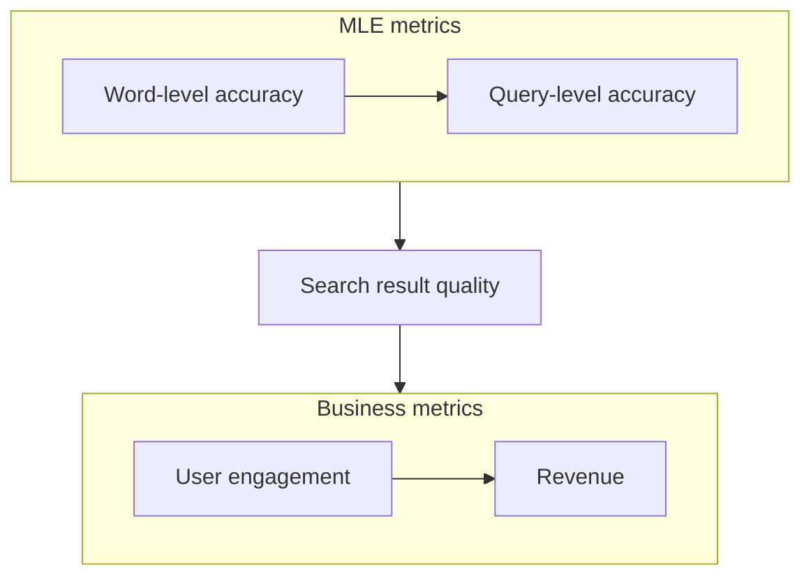
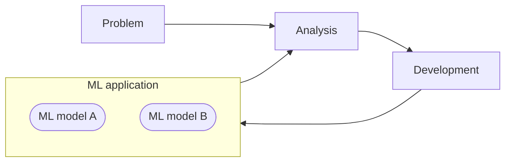
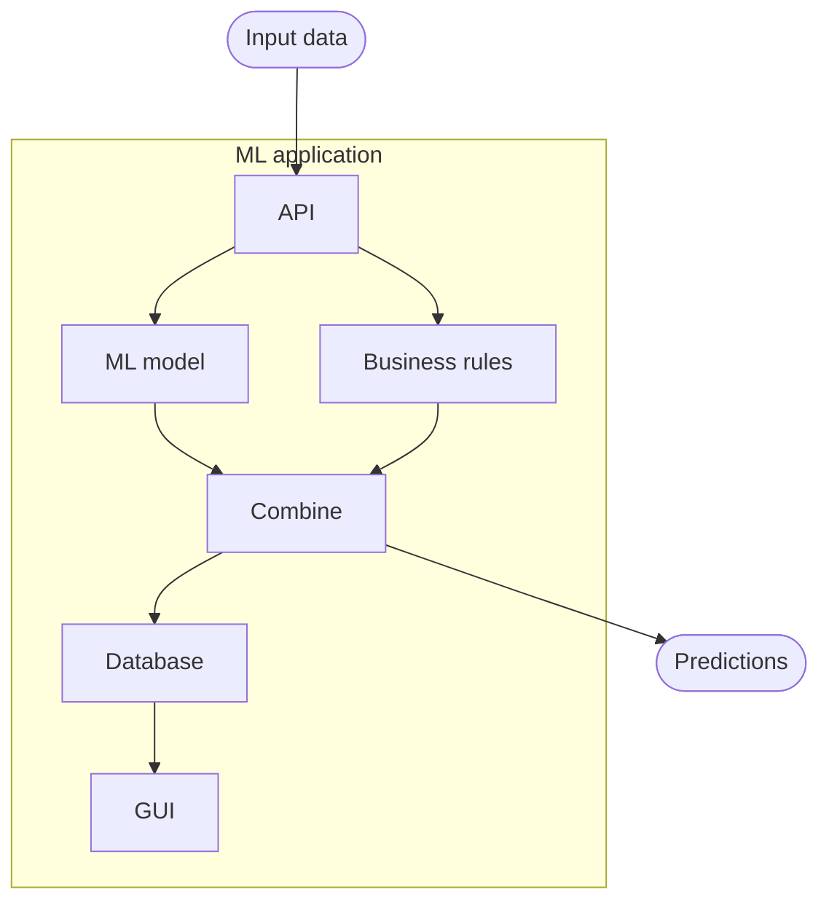
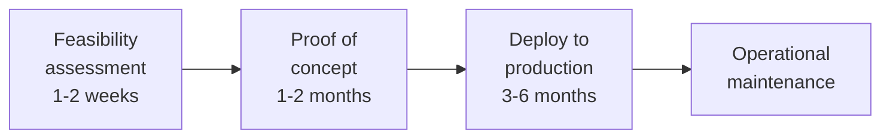

# 2.1 Scoping

## 2.1.1 Scoping Overview

Choosing the right ML project is a rare and valuable skill. Careful scoping—evaluating options and selecting high-impact projects—maximizes success.

Take an e-commerce retailer looking to increase sales. Candidate projects include a better recommender system, better search, improved catalog data, inventory management, and price optimization. Scoping answers three questions:

  - What project should we work on?
  - What are the metrics for success?
  - What resources (data, time, people) are needed?

## 2.1.2 Scoping Process

Scoping involves identifying business problems, brainstorming AI solutions, and assessing feasibility and value.

1.  Identify business problems (not AI problems).
2.  Brainstorm AI solutions.
3.  Assess the feasibility and value of potential solutions.
4.  Define milestones, metrics, and resources.

Using the e-commerce retailer from 2.1.1 as the example:

### Identify Business Problems

  - Collaborate with business owners to brainstorm problems (e.g., low conversions, excess inventory, low profit margins).
  - Focus on business objectives, not AI solutions. Ask, “What are the top three things you wish worked better?” Avoid AI-specific discussions initially.
  - Ask "why?" until the root problem appears. In one of Yan's earlier roles, the logistics team asked him to boost the ranking of products marked Fulfilled By Lazada. Why? Those products are delivered faster. Why does that matter? Faster delivery means fewer complaints about late orders. The root problem was late deliveries, which made it a delivery forecasting problem (reduce how often the forecast underestimates delivery time), not a ranking one. *(Yan, [The Metagame of Applying ML](https://eugeneyan.com/writing/machine-learning-metagame/))*

### Brainstorm AI Solutions

  - Once problems are clear, explore AI solutions. Not all problems require AI, and that’s acceptable.
  - Example problems and solutions:

      - **Increase Conversions**: Improve website search, enhance product recommendations, redesign product displays, or surface relevant reviews.
      - **Reduce Inventory**: Predict demand to optimize stock, launch marketing campaigns to sell overstocked items.
      - **Increase Margins**: Optimize product selection (merchandising), recommend product bundles (e.g., camera with case).
  - Choose the frame deliberately, since the right one can have an outsized payoff. Fraud detection can flag the fraudulent transactions or greenlight the safe ones. Abuse detection on a social network can be unsupervised (outlier detection such as isolation forests, or graph clustering) or supervised, which then needs labeled data and humans in the loop. *(Yan, [The Metagame of Applying ML](https://eugeneyan.com/writing/machine-learning-metagame/))*

### Assess Feasibility and Value

  - **Feasibility**: Evaluate technical viability using benchmarks (e.g., literature, competitor solutions) and a 2x2 matrix of new vs. existing projects and unstructured vs. structured data:

| | Unstructured (e.g., speech, images) | Structured (e.g., transaction records) |
|---|---|---|
| **New** | HLP | Predictive features available? |
| **Existing** | HLP, history of project | New predictive features? History of project |

*What to check for feasibility, by project age and data type. HLP asks: can a human, given the same data, perform the task? Adapted from DeepLearning.AI, MLOps Specialization.*

  - **Unstructured Data**:

      - **New Projects**: Use HLP to assess feasibility. If humans can perform the task (e.g., detect scratches in images), an algorithm likely can too.
      - **Existing Projects**: Compare to HLP and project history (past progress predicts future gains).
  - **Structured Data**:

      - **New Projects**: Ensure predictive features exist (e.g., past purchases predict future ones).
      - **Existing Projects**: Identify new predictive features to improve performance.
  - **History of Project**: For an existing project, plot error over time. If error started at 10% and fell every quarter by a smaller amount, flattening toward HLP, extrapolate that curve to estimate how much further work can still gain.
  - **HLP for Unstructured Data**: Ensure humans receive the same data as the algorithm (e.g., only camera images for traffic light detection, not in-car views). If humans can’t perform the task, improve inputs (e.g., better cameras) before proceeding.

  - **Structured Data Feasibility**: Verify that input features (x) predict outputs (y).

Examples:

  - **E-commerce**: Past purchases predict future ones (feasible).
  - **Mall Foot Traffic**: Weather predicts traffic (feasible).
  - **Heart Disease from DNA**: Genetic data is weakly predictive (challenging).
  - **Fashion Trends from Social Media**: Predicting future trends is difficult (iffy).
  - **Stock Prices**: Historical prices are not predictive (infeasible).

  - **Feasibility checklist**: a solution can work in theory and still be impractical to build. Five factors decide it *(Managing ML Projects, [Feasibility](https://developers.google.com/machine-learning/managing-ml-projects/feasibility))*:

      - **Data availability**: enough labeled examples for every class (a classifier with few examples of some labels predicts those labels poorly); every training feature available at serving time (a click model trained on `user_age` has nothing to go on for visitors who haven't signed up); and regulations that limit storing or using the data.
      - **Problem difficulty**: has a team inside or outside the organization solved a similar problem? If not, expect a research project with no guaranteed result. Human benchmarks show how hard the task is (people classify animals in images at about 95% accuracy and handwritten digits at about 99%), and bad actors who try to exploit the model, as spammers do, turn it into a race to keep the model updated.
      - **Prediction quality**: how costly is a wrong prediction? A bad video recommendation annoys a user; wrongly flagging a video for a policy violation creates support costs or legal fees. Cost climbs steeply with the quality bar: raising precision from 99.9% to 99.99% can make a project ten times more expensive.
      - **Technical requirements**: latency, queries per second, RAM for training and serving, where the model runs (an online server, the browser, a phone, or predictions precomputed into a table), whether predictions must be explained, and how often the model must be retrained. Most projects give up some model quality to meet them.
      - **Cost**: people (deploying and maintaining a system takes more of them than a prototype), machines (compute, labeling, data licenses), and inference (does each prediction earn more than it costs?).

  - **Value**: Estimate business impact, bridging ML and business metrics:

      - ML teams optimize metrics like word-level accuracy (e.g., in speech recognition), while businesses prioritize user engagement or revenue.
      - Use Fermi estimates to relate ML improvements (e.g., 1% word accuracy increase) to business outcomes (e.g., 0.7% query accuracy increase, improving user engagement and revenue).
      - Compromise on metrics that both teams accept, requiring ML teams to stretch toward business goals and business teams to accept technical constraints.

*From the metrics ML engineers optimize to the ones the business cares about. Each team stretches toward the other until both are comfortable with the agreed metrics. Adapted from DeepLearning.AI, MLOps Specialization.*

  - **Ethical Considerations**: Ensure the project creates positive societal value and is fair and unbiased, and that any ethical concerns have been openly aired and debated. Consult industry-specific ethical frameworks (e.g., for lending, healthcare, or retail). If a project lacks societal benefit, consider abandoning it, even if economically viable. Google groups the concrete checks under fairness, privacy, transparency, and safety: see [Privacy and Data Rights](data.md#privacy-and-data-rights) for privacy, [3.7.5](../development/performance-auditing.md#375-fairness-and-safety-checks) for fairness and safety, and model cards in [4.4.1](../deployment/reproducibility-cicd.md#441-pipelines-not-models) for transparency *(Managing ML Projects, [AI and ML Ethics](https://developers.google.com/machine-learning/managing-ml-projects/ethics))*.

      - **Example**: Yan once built a model that predicted chronic diseases (e.g., diabetes, cardiovascular disease) 2–3 years ahead from a person's health history. The plan was a preventive-care partnership with insurers, cutting their payouts while improving people's health. One insurer asked instead for the people who would *not* develop chronic disease, so it could sell them more insurance, a use that could end up discriminating against the people who most need health insurance. He walked away. *(Yan, [The Metagame of Applying ML](https://eugeneyan.com/writing/machine-learning-metagame/))*

### Choose Among Candidate Problems

Feasible candidates usually outnumber the people available to work on them, so compare them on net benefit: benefits minus costs *(Yan, [Choosing Problems in DS and ML](https://eugeneyan.com/writing/how-to-choose-problems/))*.

  - **Benefits**: express them as extra revenue or lower cost. In a hypothetical example, about \$10 million of wishlisted products are restocked or drop more than 10% in price each month; alerts that convert 1% of that bring in \$100,000 a month. Weigh **extent** (how many customers are affected) against **severity** (how badly): a 5% gain on fashion search, which handles 50% of queries, lifts overall search by 2.5%, while a 10% gain on the weaker electronics search, with 20% of queries, lifts it by 2%. Treat these numbers as inputs, not verdicts: if electronics search is bad enough to drive customers away, it may still be the better pick.
  - **Costs**: mostly people (monthly compensation times months of development), plus 2–4 weeks a year to operate and maintain the system (on-call, software updates), plus infrastructure for training jobs and, with online inference, for serving.
  - **Capabilities and learning exercises**: work with no direct customer benefit can still pay off. A feature store, a pipeline that lets data scientists deploy their own models, or shared embeddings act as **multipliers**: halve the development cycle and the team can take on twice as many problems. When it's unclear whether a problem can be solved at all, a learning exercise of a month or two can settle it.
  - **Incremental vs. disruptive**: incremental improvements ship fast and earn the team trust, but they eventually plateau; a disruptive change, such as a new system that replaces the old one, can deliver a step up. Picking a mix of both works best over the medium to long term.
  - **Pitfalls**: **resume-driven development** (using the newest technique because it looks impressive, not because it works best) and taking on **someone's pet project** without thinking it through, only for the sponsor to lose interest. A [one-pager](../templates.md) agreed with the stakeholder helps secure their commitment to follow through.

### Define Milestones, Metrics, and Resources

  - Specify **ML metrics** (e.g., accuracy, precision-recall, fairness), **software metrics** (e.g., latency, throughput), and **business metrics** (e.g., revenue increase).
  - **Business metrics come first**, since they are the reason for the project. Make them specific and quantified: cut a data center's monthly electricity cost by 30%, or raise revenue from recommendations by 12%. If you don't measure the metric yet, instrument it before setting a target ([2.1.4](#instrument-metrics-before-building-the-model)). Expect it to move once you launch: revenue from recommendations can rise while subscriptions fall. *(Managing ML Projects, [Measuring Success](https://developers.google.com/machine-learning/managing-ml-projects/success))*
  - **Optimize one model metric and set acceptability goals.** When metrics disagree on which model is best, agree on a single one to optimize, plus thresholds a model must clear to be usable at all, such as "incorrect output below 0.1%". A fraud model might optimize recall while keeping precision above a floor. *(Managing ML Projects, [Measuring Success](https://developers.google.com/machine-learning/managing-ml-projects/success))*
  - **Test the link between the two early.** Great model metrics don't guarantee a better business metric. A churn model with 95% prediction quality, tried on a small sample of users, left revenue flat and churn went up. Possible reasons: it predicted churn only seven days ahead, too late to offer an incentive; features that drive churn were missing from the training data; or the use case needed 97% or more. Release to a small share of users (often 1%) and watch the business metric before going further. *(Managing ML Projects, [Measuring Success](https://developers.google.com/machine-learning/managing-ml-projects/success))*
  - Estimate **resources**: Data volume, team involvement, cross-functional support, and timelines.
  - If specifications are unclear, conduct **benchmarking** (compare to similar projects) or build a **proof of concept** to refine estimates.
  - Agree on these with everyone involved: data scientists, subject matter experts, and business stakeholders. As early as possible, list the stakeholders, including any team that must approve part of the solution (for example, whoever grants access to personal data), what each expects to receive at each stage, and how you'll keep them informed. *(Managing ML Projects, [Working with Stakeholders](https://developers.google.com/machine-learning/managing-ml-projects/stakeholders))*

## 2.1.3 Workflows

### Project Workflow

An ML project moves from defining the problem to analysis (exploring the data, considering candidate models) to development, and ends in an ML application that may hold several models. What the application reveals in use feeds back into analysis and development, so the loop repeats.

*An ML project: development produces an application that can hold several models, and what the application shows in use feeds back into analysis.*

### The Model Inside an Application

At its core, a model is a function: it takes input data and returns predictions.

In an application, the model sits behind an API. The API passes the input data both to the model and to business rules, their outputs are combined into the final predictions, and those are returned and stored in a database that a GUI reads from. Deployment architecture is covered in [4.2](../deployment/architecture.md).

*Inside an ML application: the API passes input data to the model (a classifier, regressor, or any other kind) and to business rules. Their outputs are combined into predictions, which are returned and stored in a database for a GUI to read.*

The application and the model have separate lifecycles. The model can be retrained and updated without a new application release, and the application can ship changes without touching the model.

| Lifecycle | Earlier | | | | Later |
|---|---|---|---|---|---|
| Application | | App v1.2.0 | | App v2.0.0 | |
| Model | Model v1 | | Model v2 | | Model v3 |

*Application and model releases on one timeline: each version history advances on its own schedule.*

### Business Rules on Top of the Model

In Yan's experience, nearly every mature ML system has a **business rules layer** that brings domain expertise and business constraints to the model's output, adjusting or overriding it. Recommenders show it most often: Instagram's sample recommender ends with a round-robin diversification step; Twitter combines its ranker's predicted engagement probabilities with hand-tuned weights and then applies heuristics such as author diversity; Netflix calibrates recommendations to match the mix of genres a user has watched before. *(Yan, [More Design Patterns for ML Systems](https://eugeneyan.com/writing/more-patterns/))*

  - **Pros**: outputs stay within business requirements and constraints, which makes the system more reliable, safe, and usable.
  - **Cons**: managed poorly, the rules grow into a tangle that overrides itself in unexpected ways, and they invite patching a short-term problem with one more rule instead of fixing its cause.

The policy layer in [2.1.5](#use-a-policy-layer-for-extra-logic) follows the same idea: keep the training objective simple and make final adjustments on top.

## 2.1.4 Before Machine Learning

Most of the problems in an ML project are engineering problems, and most of the gains come from good features rather than clever algorithms. Zinkevich sums it up as: "do machine learning like the great engineer you are, not like the great machine learning expert you aren't." *(Rules of ML, Overview)*

### Explore the Data First

Whether the first version uses rules or deep learning, start by understanding the data: take a sample, compute summary statistics, and plot it (easiest for tabular data). Correlations show which features relate most to the target, and those are the ones to plot. Don't trust the numbers alone: temperature can have zero correlation with ice cream sales, yet a scatter plot shows sales climbing as it warms up and falling once it's too hot to go out. Use **scatter plots** for a numeric feature against the target, and **box plots** when either variable is categorical (e.g., a dog's lifespan by breed size). *(Yan, [Start without ML](https://eugeneyan.com/writing/first-rule-of-ml/))*

### Launch Without ML First

ML needs data. If ML would give a 100% improvement, a simple heuristic often gets you 50% of the way there. Rank apps by install count, block senders who spammed before, rank contacts by most recent use. If the product does not strictly need ML, ship it without ML until you have data. *(Rules of ML #1)*

### Heuristic Baselines That Are Hard to Beat

Simple rules are often surprisingly hard to beat, for a fraction of the effort *(Yan, [Start without ML](https://eugeneyan.com/writing/first-rule-of-ml/))*:

  - **Recommendations**: the previous period's top items, optionally per category or brand; with behavior data, item-to-item similarity computed from how often items are interacted with together.
  - **Product classification**: regex rules on product titles. Walmart's classifier, for example, files titles containing "ring" or "wedding band" under rings.
  - **Review spam**: rules on the number of reviews from one IP address, odd posting times (3 a.m.), and how similar a review is to others posted that day.
  - **Other baselines** suggested by practitioners: interquartile ranges for outlier detection, moving averages for forecasting, dictionaries for address matching.

The same heuristics can bootstrap labels: written as **labeling functions**, they quickly produce many lower-quality labels, a form of weak supervision covered in [2.2.6](data.md#226-obtaining-data). *(Yan, [Start without ML](https://eugeneyan.com/writing/first-rule-of-ml/))*

### Instrument Metrics Before Building the Model

Track as much as possible in the current system before formalizing what the ML system will do:

  - Permission to log is easier to get early on.
  - Historical data for a future concern is only available if you started collecting it.
  - Systems designed with instrumentation in mind are easier to evaluate later (no grepping logs to rebuild a metric).
  - You learn which metrics move and which stay flat when the product changes.

Pair this with an experiment framework that buckets users and aggregates statistics per experiment. Whenever you notice a problem or a change worth celebrating, add a metric for it. *(Rules of ML #2)*

### Replace Complex Heuristics with ML

A simple heuristic gets the product out the door; a complex one becomes unmaintainable. Once you have data and a clear goal, move to ML: a learned model is easier to update and maintain than a growing pile of rules. *(Rules of ML #3)*

### Signs You Are Ready for ML

Move to ML once a non-ML baseline performs reasonably well and maintaining or improving it costs more than building and deploying a model. One sign: the hand-written rules (195 of them, in Yan's example) can no longer be changed without breaking something. Another is having robust data pipelines and good labels. Without them, ML has little to learn from: you may not yet know what fraud on your platform looks like, or merchants may misfile products into categories with lower commissions, corrupting the labels a product classifier would train on. Hand-labeling a **golden dataset** often comes first, and it makes both training and validating the model easier. *(Yan, [Start without ML](https://eugeneyan.com/writing/first-rule-of-ml/))*

## 2.1.5 Choosing the Objective

A **metric** is any number the system reports. An **objective** is the one metric the algorithm directly optimizes. Measure many metrics; optimize one.

### Don't Overthink the First Objective

Early on, most metrics rise together, even the ones you don't optimize directly (optimizing clicks usually lifts time on site too). Don't spend effort balancing metrics while they are all still easy to improve. If the optimized metric goes up but the team decides not to launch, the objective needs revisiting. *(Rules of ML #12)*

### Pick a Simple, Observable, Attributable Objective

The ML objective should be easy to measure and act as a proxy for the "true" goal, which is often unknown or disputed. The easiest things to model are user actions directly caused by the system:

  - **Model directly**: Was the ranked link clicked, the object downloaded, forwarded, rated, or flagged as spam?
  - **Use as metrics, not objectives**: Indirect effects such as next-day return, session length, or daily active users. These belong in A/B tests and launch decisions.
  - **Leave to human judgment**: User happiness, satisfaction, well-being, and company health. Connect these to proxies rather than asking the model to learn them.

*(Rules of ML #13)*

### Engineer the Reward Early

The reward function decides what counts as a good outcome, and so defines the labels; Yan calls getting it right half the battle. Each kind of reward has a catch: short-term rewards miss part of the picture, long-term rewards arrive late and are hard to attribute, proxy rewards are fickle and may not track business metrics, and most are sparse, since feedback events are rare. Put effort into designing the reward early, alongside turning the messy real world into data and finding the levers that move the outcome. *(Yan, [39 Lessons on Building ML Systems](https://eugeneyan.com/writing/conf-lessons/))*

### Use a Policy Layer for Extra Logic

Train on the simple objective and add a thin **policy layer** on top for final adjustments. Keep adversarial problems separate: quality ranking should assume good-faith content, while spam filtering is an arms race with fast-changing features, hard rules, and frequent retraining. Remove spam from the quality model's training data and merge the two systems' outputs in the policy layer. *(Rules of ML #13, #15)*

### Launch Decisions Are Proxies for Long-term Goals

A model can lower log loss and raise installs in an A/B test, yet still be rejected because daily active users dropped 5%. Launch decisions weigh several metrics (engagement, DAU, revenue, partner ROI), and each of those is itself a proxy for long-term goals like a healthy product five years out. Only launches where all metrics improve (or none get worse) are easy. If a simple heuristic beats a sophisticated model on every metric, ship the heuristic. *(Rules of ML #39)*

When metrics plateau and the team starts arguing about issues outside the current objective, stop adding features: either change the objective or change the product goals. *(Rules of ML #38)*

### Mediate Conflicting Objectives

Every ML system trades something off: recall vs. precision, exploring vs. exploiting, relevance vs. diversity, accuracy vs. speed vs. cost. The work is finding the balance that suits the user experience. *(Yan, [39 Lessons on Building ML Systems](https://eugeneyan.com/writing/conf-lessons/))*

Objectives can be clear and still conflict, which leaves you mediating between stakeholders. In one case Yan cites, a practitioner offered to optimize conversion and revenue jointly and got pushback, because some stakeholders wanted to favor one over the other. Optimizing conversion tends to push cheaper products into recommendations and search results, and optimizing revenue the reverse: groceries are cheap and bought weekly, while a phone is bought every 2–3 years. Categories can also want different things, such as revenue for electronics and stickiness and repeat purchases for fast-moving consumer goods. *(Yan, [The Metagame of Applying ML](https://eugeneyan.com/writing/machine-learning-metagame/))*

Agree on the **measurement period** as well: a single session, a long-term estimate such as a year, or something in between (long-term effects can be estimated with methods such as double machine learning). Some customers weigh heavily on long-term metrics: new parents who settle on a brand of diapers or formula tend to stay with it for years, and weekly grocery shopping drives stickiness and customer lifetime value. *(Yan, [The Metagame of Applying ML](https://eugeneyan.com/writing/machine-learning-metagame/))*

## 2.1.6 Project Phases and Timeboxes

*Project phases with their timeboxes. Once in production, the system moves to operational maintenance: fix critical issues as necessary and update it if stakeholders prioritize it. Adapted from Eugene Yan, [Writing Docs: Why, What, and How](https://eugeneyan.com/writing/writing-docs-why-what-how/).*

A project usually starts with a **feasibility assessment**. With the existing data and technology, can the problem be solved? If so, to what extent? This stage is a quick and dirty investigation, typically time-boxed at 1-2 weeks.

After feasibility comes a **proof of concept** (POC): a prototype *hacked* together to assess whether the solution is technically achievable. Ideally, it also tests the integration points with upstream data providers and downstream consumers. Can we meet the technical constraints (e.g., latency, throughput)? Is model performance satisfactory? This usually takes a month or two.

If all goes well, the next stage is to **develop for production**, also time-boxed. An overly generous timeline can lead to non-essential features being squeezed in and never-ending development, and until the system is deployed, no one benefits from it. This usually takes 3-6 months, including infra, job orchestration, testing, monitoring, documentation, etc.

Each phase is a natural point to write one of the documents in [Templates](../templates.md). These phases line up roughly with the three stages of these notes and with Google's four phases (see [1.2.4](../overview/lifecycle.md#124-goals-and-exit-outcomes)).

### Planning Under Uncertainty

ML progress isn't proportional to effort, which makes timelines hard to estimate *(Managing ML Projects, [Planning](https://developers.google.com/machine-learning/managing-ml-projects/planning))*:

  - In one Kaggle competition, the top teams raised prediction quality from 35% to 65% in the first few weeks. Over the next two weeks the field grew from 350 teams to 1,400, and the best model reached only 68%.
  - In an industry example, two teams took several months to get a model to 90% prediction quality; getting it to the 99.9% needed for production took several teams more than five years.

So plan the work as a series of experiments rather than a fixed path *(Managing ML Projects, [Planning](https://developers.google.com/machine-learning/managing-ml-projects/planning))*:

  - **Timebox each step** (see below): for example, two weeks to find out whether the right data can be had, two more to see whether a simple model works, and two more for a neural net if it doesn't. Each step ends with enough information to decide whether to continue.
  - **Scope down** an ML feature the product doesn't strictly need: ship a very simple version this quarter and improve it over the next ones. Many teams have reached impactful ML this way.
  - **Give an open question to an intern or a new hire**, with guidance, to learn how much effort a solution would take before committing a team to it.
  - **Fail fast**: try the cheapest approaches with the highest potential payoff first. Estimate each approach's cost and chance of success, keep a portfolio of them, change one thing at a time, and plan for some to fail.

Treat the plan as a living document that changes as experiments come back, and reserve more slack than you would for a non-ML project, especially under a tight deadline. *(Managing ML Projects, [Planning](https://developers.google.com/machine-learning/managing-ml-projects/planning), [Feasibility](https://developers.google.com/machine-learning/managing-ml-projects/feasibility))*

### Setting Timeboxes

Timebox each phase and task. ML work is less well-defined than most engineering work, and much of it is research and experiments that end up as dead ends, which is exactly why timeboxes help: they force the question of how much effort a direction deserves before pivoting. A timebox is a stretch goal, not an estimate; to turn one into an estimate for project planning, multiply it by 1.5–3. *(Yan, [Mechanisms for Effective ML Projects](https://eugeneyan.com/writing/mechanisms-for-projects/))*

| Approach | How to set it | Best for |
|---|---|---|
| Aggressive | Halve the time similar projects took, which forces a scrappy first version and fast feedback | Startup-like teams; too intense to use all the time |
| Comfortable yet challenging | Cut the time similar projects took by 10–20% | A good default for experienced teams |
| Standard | Fixed blocks, e.g., 2 weeks of literature review, 4–8 weeks for a prototype, 3–6 months for production | Greenfield projects that are hard to scope |

*Three ways to set a timebox. Adapted from Eugene Yan, [Mechanisms for Effective Machine Learning Projects](https://eugeneyan.com/writing/mechanisms-for-projects/).*

### Pilot and Copilot

With two or three problems per person, projects rarely get looked at outside standups and planning, so one can drift for months, or a critical error (wrong training data, an invalid train-validation split) can stay hidden until late in implementation. Give each project a **pilot**, who owns it, does most of the design and critical code, and answers for its success, and a **copilot**, who checks in periodically, reviews documents and prototypes, is a mandatory code reviewer, and challenges a design that doesn't solve the business problem. The copilot usually knows the problem space or has more experience, and spends about one hour for every ten the pilot spends (10%), which costs less than reworking or abandoning a project after mistakes snowball. The two can come from different disciplines: a scientist and an engineer can act as each other's copilot and learn from each other's work. *(Yan, [Mechanisms for Effective ML Projects](https://eugeneyan.com/writing/mechanisms-for-projects/))*

### Methodology Review

Once a prototype has its first experiment results, review its methodology with fellow scientists, the way code gets reviewed, to catch blind spots and critical errors. Useful questions *(Yan, [Mechanisms for Effective ML Projects](https://eugeneyan.com/writing/mechanisms-for-projects/))*:

  - **Inputs and features**: does the model use anything that won't be available at inference time? A model that predicts hospitalization cost before admission can't use length of stay: it isn't known in advance and is highly correlated with cost, so using it is a leak.
  - **Offline evaluation**: is the data split by time or at random? For a forecast, a random split lets the model learn from the future; most production use cases should split by time (see [3.2.4](../development/validation-and-tuning.md#324-choosing-a-splitting-strategy)).
  - **Room for improvement**: what's the best result achievable, for example by letting the model overfit, training and predicting on the same data? How much would more data help, judging by learning curves?
