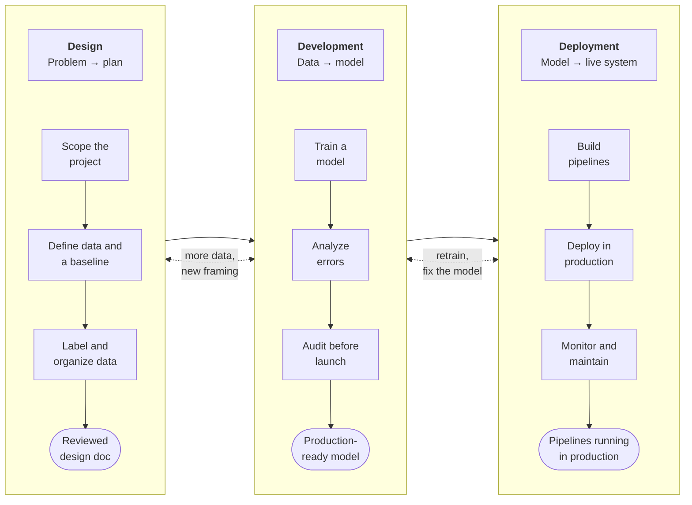

# 1.2 ML Project Lifecycle

When building a machine learning (ML) system, planning the project lifecycle helps outline all necessary steps effectively. As you work on an ML system, this framework will help you identify critical tasks, ensure the system functions properly, and minimize unexpected challenges.

The ML project lifecycle consists of iterative stages that guide the development and deployment of an ML system.

*The ML project lifecycle: each stage's steps and the outcome that closes it (see [1.2.4](#124-goals-and-exit-outcomes)). The dashed edges are the ways back: error analysis can call for more data or a new framing, and monitoring can call for retraining or a fix to the model. Adapted from DeepLearning.AI, MLOps Specialization, and Google for Developers, Managing ML Projects.*

The iterative nature of this lifecycle means feedback from later stages often informs adjustments to earlier ones. ML projects are often highly iterative. During error analysis, you may need to refine the model or revisit earlier steps to collect additional data. Before deployment, you typically perform a final check or audit to verify that the system’s performance is adequate and reliable for its intended application. Deploying a system for the first time means you’re only about halfway to completion. Live traffic often reveals critical insights needed to optimize performance.

## 1.2.1 Design

**Scoping**

Begin by defining the project and deciding what to focus on. Specify the ML application, including what X (input) and Y (output) represent.

  - Define project objectives, specifying inputs (X) and outputs (Y).
  - Establish performance metrics (e.g., accuracy, latency, throughput).
  - Estimate required resources (e.g., time, compute, budget).

**Data**

After selecting the project, gather the required data for your algorithm. This involves defining the data, establishing a baseline, labeling, and organizing it.

  - Collect, label, and organize data, ensuring quality and consistency.
  - Address issues such as inconsistent labeling or missing values.
  - Establish a performance baseline (covered in [3.3 Model Baseline](../development/model-baseline.md)).

Covered in depth in [2 · Design](../index.md#2--design), starting with [2.1 Scoping](../design/scoping.md).

## 1.2.2 Development

With data in hand, proceed to train the model. This phase includes selecting and training the model and conducting error analysis.

  - Select and train a model using the prepared dataset.
  - Conduct error analysis to identify improvement areas.
  - Iterate on model architecture, hyperparameters, or data as needed.

Covered in depth in [3 · Development](../index.md#3--development), starting with [3.1 Modeling Overview](../development/modeling-overview.md).

## 1.2.3 Deployment

To deploy the system, integrate it into production, develop the necessary software, and monitor the system. Continuously track incoming data and maintain the system’s performance. For instance, if the data distribution shifts, you may need to update the model.

  - Build the pipelines that keep the model fresh: data, training, validation, and serving (see [4.4.1](../deployment/reproducibility-cicd.md#441-pipelines-not-models)).
  - Integrate the model into a production environment (e.g., via APIs).
  - Ensure compliance with performance requirements (e.g., latency, throughput).
  - Address operational constraints (e.g., resource availability, security).

**Maintenance**

Post-deployment maintenance often involves further error analysis, retraining the model, or incorporating new data. As the system runs on live data, its output can be fed back into the dataset to update the data, retrain the model, and deploy an improved version.

  - Monitor system performance for issues like concept or data drift.
  - Update the model with new data or retraining as required.
  - Refine the system based on real-world feedback.

Covered in depth in [4 · Deployment](../index.md#4--deployment), starting with [4.1 Key Challenges](../deployment/key-challenges.md).

## 1.2.4 Goals and Exit Outcomes

A stage is done when it has produced something you can check, not when its time runs out. Naming that outcome up front tells the team what to aim for, and gives stakeholders a milestone to look for: people used to deterministic software often read a stalled week or uneven progress as a project in trouble, so be clear about what each stage delivers and how long it may take *(Managing ML Projects, [Development Phases](https://developers.google.com/machine-learning/managing-ml-projects/phases), [Working with Stakeholders](https://developers.google.com/machine-learning/managing-ml-projects/stakeholders))*.

| Stage | Goal | Exit outcome | Google's phase | Yan's phase and timebox |
|---|---|---|---|---|
| Design | Decide whether ML is the right tool, what it should optimize, and what data it needs | A design doc reviewed with stakeholders and peers (see [Templates](../templates.md)) | Ideation and planning | Feasibility assessment, 1–2 weeks |
| Development | Build a model that solves the business problem well enough to deploy | A model good enough for production, plus the record of experiments behind it | Experimentation | Proof of concept, 1–2 months |
| Deployment | Keep the model good on live data | Validated pipelines for data, retraining, validation, and serving, running in production | Pipeline building, then productionization | Develop for production, 3–6 months, then operational maintenance |

*Each stage's goal and the outcome that closes it, next to the two other phase models these notes draw on. The rows line up only roughly: Google counts all data work as part of experimentation, while these notes, following Ng, start defining and labeling data in design. Adapted from Google for Developers, Managing ML Projects, and Eugene Yan, [Writing Docs: Why, What, and How](https://eugeneyan.com/writing/writing-docs-why-what-how/).*

Google splits deployment into two phases because the deliverable changes: in production the goal isn't one model but automated pipelines that keep replacing it with a fresh one (see [4.4.1](../deployment/reproducibility-cicd.md#441-pipelines-not-models)). When an outcome is out of reach, work goes back a stage *(Managing ML Projects, [Development Phases](https://developers.google.com/machine-learning/managing-ml-projects/phases))*:

  - **Experiments don't produce a viable model**: go back to scoping and frame the problem again.
  - **Building the training pipeline exposes a flaw in the model**: go back to development.
  - **Deploying exposes a problem in the pipeline**: fix the pipeline before going further.
  - **The live system needs better predictions**: go back to development and train a better model.

## 1.2.5 Roles

An ML project needs both business and technical people. Business roles define the problem and judge whether the result is useful; technical roles build the data pipelines, the model, and the system around it.

On the business side, the main roles are the **business stakeholder** and the **subject matter expert**. On the technical side, each role has its own deliverable:

| Role | What they do | Main deliverable |
|---|---|---|
| ML product manager | Matches business problems to ML solutions with the team, end users, and stakeholders; sets the product vision, use cases, and requirements; prioritizes projects | Product requirements document (PRD) |
| Engineering manager | Sets and communicates the team's priorities, aligns ML work with business goals, and manages and develops the people on the team | Design docs, project plans, and performance reviews |
| Data scientist | Uses statistical analysis to find and test features, prototype models, and explain what they do | Reports and visualizations that answer business questions |
| ML engineer | Designs, builds, productionizes, and maintains models; a strong software engineer who knows ML well | A deployed model good enough to meet the business goals |
| Data engineer | Builds the pipelines that collect, store, and transform raw data for training and serving, and owns the data across the project | Production data pipelines with monitoring and alerting |
| DevOps engineer | Builds, deploys, scales, and monitors the serving infrastructure | Automated serving, monitoring, testing, and alerting for the model |

*The usual roles on an ML team and what each delivers. On a small team, one person covers several. Adapted from Google for Developers, [Managing ML Projects](https://developers.google.com/machine-learning/managing-ml-projects/team).*

### Team Practices

People arrive with different habits: one engineer thinks getting the right data is enough to start training, another first checks that it is anonymized and records where it came from. Agree on tools, infrastructure, and processes before writing code, and write them down in process docs that answer questions like these *(Managing ML Projects, [Assembling a Team](https://developers.google.com/machine-learning/managing-ml-projects/team))*:

  - How is the training data generated, and how do we examine, validate, and visualize it?
  - How do we change a feature or a label, and the model architecture to match?
  - Which metrics judge model quality, and where do test examples come from?
  - How do we launch a model, and how will we know something is wrong with it?
  - Which upstream systems does the model depend on?

Because ML outcomes are uncertain, set expectations and deliverables early, and don't tie a person's performance review to whether the project succeeds. Weeks spent on an approach that fails can still produce high-quality code, thorough documentation, and good collaboration, and those should count. *(Managing ML Projects, [Assembling a Team](https://developers.google.com/machine-learning/managing-ml-projects/team))*

### End-to-End Ownership

Splitting one project across many specialists has costs. Yan argues that a data scientist is more effective when they own the problem from framing to the deployed model and its measured outcome *(Yan, [Data Scientists Should Be More End-to-End](https://eugeneyan.com/writing/end-to-end-data-science/))*:

  - **Context to find the root cause**: when conversion drops and the request is "improve the search algorithm", the cause may lie elsewhere: low-quality products eroding customer trust, delayed or broken data pipelines, or a model that no longer refreshes. Someone who sees the whole chain is more likely to find it, and to know which engineering and product constraints rule a solution out.
  - **Lower coordination cost**: a team of N people has N(N-1)/2 relationships to maintain, so 7 people have 21 and 21 people have 210. With a data engineer, a data scientist, and an ML engineer working in sequence, each new dataset or model waits for the next person; the work itself may take days while the handoffs take weeks.
  - **Ownership**: when features, model code, and production code are thrown over the wall from one role to the next, no one is clearly responsible when results go wrong. At Lazada, a ranking model Yan built won its A/B test, yet business stakeholders didn't trust it and kept picking top products by hand, which pulled the online metrics down; visits to the regional markets to explain the model and hear their concerns reduced the overrides.

Specialists are still needed: some people want to go deep, research pushes the field forward, and in systems such as algorithmic trading or advertising a 0.01% gain is worth hyper-specialization. End-to-end work also depends on a solid platform: Stitch Fix's generalists rely on one that hides infrastructure setup, distributed processing, and monitoring, and at Netflix central teams built shared tooling for build and deploy pipelines, monitoring, and managed rollbacks. Yan later clarified that the point is end-to-end visibility and ownership, not full-stack skills: you need to use the tools well, not be able to build them from scratch. *(Yan, [Data Scientists Should Be More End-to-End](https://eugeneyan.com/writing/end-to-end-data-science/))*
