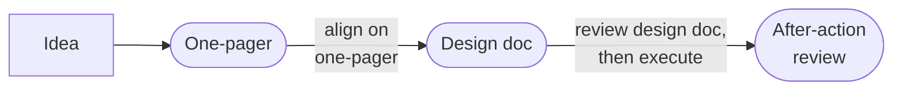

# Templates

Write three types of documents when building/operating a system. The first two help to get alignment and feedback; the last is used to reflect, and all three assist with thinking deeply and improving outcomes.

*The document types below are adapted from Eugene Yan, [Writing Docs: Why, What, and How](https://eugeneyan.com/writing/writing-docs-why-what-how/); the first-person voice in the original is his.*

*Where each document falls on a project timeline (not to scale). Adapted from Eugene Yan, *Writing Docs: Why, What, and How*.*

**One-pagers:** Used to achieve alignment with business/product stakeholders. Also used as background memos for quarterly/yearly prioritization. In a single page, they should allow readers to quickly understand the problem, expected outcomes, proposed solution, and high-level approach. Extremely useful to reference when you’re deep in the weeds of a project, or encounter scope creep.

**Design docs:** Used to get feedback from fellow scientists and engineers. They help identify design issues early in the process. Furthermore, you can iterate on design docs more rapidly than on systems, especially if said systems are already in production. It usually covers methodology and system design, and includes experiment results and technical benchmarks (if available).

Design docs are more commonly seen in engineering projects; not so much for data science/machine learning. Nonetheless, Yan finds them invaluable for building better ML systems and products. What an ML design doc covers, and how to review one, is under [Design Docs for ML Systems](#design-docs-for-ml-systems) below.

**After-action reviews:** Used to reflect after shipping a project, or after a major error. A project review covers what went well (and not so well), follow-up actions, and how to do better next time. It’s like a [scrum retrospective](https://eugeneyan.com/writing/what-i-love-about-scrum-for-data-science/#retrospectives-feedback-loop-for-improvement), except with more time to think and written as a document. The knowledge can then be shared with other teams.

An error review (e.g., the system goes down) diagnoses the root cause and identifies follow-up actions to prevent reoccurrence. Nobody is blamed. The intent is to discuss what the team can do better and share the (sometimes painful) lessons with the greater organization. Amazon calls these [Correction of Errors](https://aws.amazon.com/blogs/mt/why-you-should-develop-a-correction-of-error-coe/); here’s [what one looks like](https://github.com/JDHarris007/coe/blob/master/CoE.md).

**Where each fits in the lifecycle**

  - **One-pager**: during scoping, before any data work ([2.1 Scoping](design/scoping.md)).
  - **Design doc**: before building, to get feedback on methodology and system design while changes are still cheap ([2.1.6 Project Phases and Timeboxes](design/scoping.md#216-project-phases-and-timeboxes)).
  - **After-action review**: after shipping, or after a production incident ([4 · Deployment](index.md#4--deployment)).

Google's *Managing ML Projects* course adds two more: a **process doc**, written before the first line of code, records how the team works ([Process Docs](#process-docs)), and a **handover doc** goes with the production system to the engineers who will maintain it ([Handover Docs](#handover-docs)).

## Design Docs for ML Systems

*Adapted from Eugene Yan, [How to Write Design Docs for Machine Learning Systems](https://eugeneyan.com/writing/ml-design-docs/).*

A design doc does two jobs: writing it makes the author work through the problem, and because it stands on its own, reviewers can comment on it asynchronously. Skipping it raises the odds of building the wrong thing, or a requested feature nobody ends up using, or of finding a design flaw (a vague problem statement, a technology choice that can't scale) only after months of work.

**Why and what:** Start with the motivation: the benefit to customers or the business, why now, and why improving the current system won't do. Then state the success criteria (business goals like engagement, revenue or cost, or new capabilities such as rolling back models), the requirements and constraints, what is in and out of scope (including any tech debt taken on deliberately, with a plan to pay it off), and the assumptions about the environment, such as the number of users and items or the expected requests per second, since they shape how the problem gets framed. ML systems add requirements of their own, for example:

  - **Recommendations**: the share of customers or items that get more than five recommendations.
  - **Fraud detection**: a ceiling on the number or rate of false positives.
  - **Automated classification**: a limit on how many low-confidence predictions are sent to people for review.

**Methodology:** This reads like the methods section of a paper:

  - **Problem statement**: how the problem is framed (content-based or collaborative, candidate generation or ranking) and which surrogate problem the model solves. Predicting ratings, the chance a video gets played and minutes watched are three different stand-ins for "good recommendations", and the choice has a large effect on A/B test results.
  - **Data**: the entities and events the model learns from, with privacy in mind when they describe customers.
  - **Techniques**: what will be tried, the baselines to compare against, and how data is prepared and features are built, in enough detail to reproduce.
  - **Validation and experiments**: how models are evaluated offline (Yan treats a time-based split as the safe default) and why those metrics should track production. For an A/B test, say whether users or sessions are randomized, and separate **success metrics** from **guardrail metrics**, which protect the customer experience and must not get worse however much the success metrics improve.
  - **Human-in-the-loop**: where people can step in, e.g., category managers keeping some product categories off the home page, customers opting out of recommendations, or dollar thresholds that force human approval of fraud or loan decisions.

**Implementation:** The engineering side, where it helps to bring in engineers: a high-level diagram (system context or data flow), infrastructure and how it scales, throughput and latency targets (e.g., at p99), security, data privacy (personal data, retention and deletion), monitoring and the alarms that page someone, cost including people, integration points such as the API contract, and the known risks and open questions. Cover only what matters for the system at hand.

**Alternatives considered:** List the options rejected, with their pros and cons and the reasoning. The decision rests on assumptions about the environment, so when those change, this section shows which decisions to revisit.

**Two-stage review:** First, a **pre-review**: share a rough outline one-on-one with a teammate or mentor while the design can still change direction, and say plainly that it is an early draft. Then the **review**: a formal session with senior engineers and decision-makers, on a complete doc in prose with quantified estimates (throughput, latency, cost), offline results, diagrams, and a FAQ appendix for questions raised in the pre-review. Say what you need from it: which risks to address, which decisions to make, what help you want.

**When to write one:** when the problem or the solution is ambiguous, when the impact is high (customer-facing, or other services depend on it), or when the effort is high (several teams over a few months). Small changes like adding a feature column, or tasks of a few days, don't justify one. Templates followed to the letter turn into filling in blanks, so treat any template as a prompt for thinking; Yan keeps a deliberately minimal one at [`eugeneyan/ml-design-docs`](https://github.com/eugeneyan/ml-design-docs).

## Process Docs

A process doc records the tools, infrastructure, and processes a team uses for ML development, so that new and current members work the same way (see [Team Practices](overview/lifecycle.md#team-practices)). Agree on it before writing code, and update it as practices change. It should answer questions like these *(Managing ML Projects, [Assembling a Team](https://developers.google.com/machine-learning/managing-ml-projects/team))*:

| Area | Questions |
|---|---|
| Data | How is the training data generated? How do we examine, validate, and visualize it? How do we change a feature or a label? Where does the SQL that generates data live, and how do we keep it maintainable and reusable? |
| Model | How do we change the architecture when features or labels change? Can one pipeline train on different datasets, for example to fine-tune? How do we add a new test dataset? |
| Training and evaluation | Where do test examples come from? Which metrics judge model quality, and how do we compute standard and custom ones on a chosen dataset? How do we check a prediction on a hand-crafted example, find the examples the model gets wrong, and see which features drove a prediction? How do we compare models offline, across many evaluations at once, and against the model from 10 months ago? |
| Production | How do we launch a model, and check that it runs correctly once it is live? Where is the history of its evaluations? How will we know something is wrong, and what do we do when a page or bug mentions the model? |
| Pipelines | How do we customize the data generation, training, and evaluation pipeline, and when should we build a new one instead? |
| Infrastructure | How does serving work, and is there a diagram? Which upstream systems does the model depend on? |
| Help | Who do I contact when I'm stuck, and how? |

*What a process doc should answer, grouped by area. Adapted from Google for Developers, Managing ML Projects.*

## Handover Docs

The production-ready system, with its pipelines for training and serving, is the last deliverable, and it should come with documentation for the engineers who will maintain it. That documentation explains three things *(Managing ML Projects, [Working with Stakeholders](https://developers.google.com/machine-learning/managing-ml-projects/stakeholders))*:

  - **Modeling decisions**: why the model and its features are what they are.
  - **Deployment and monitoring**: how the model is released and what is watched once it's live.
  - **Data peculiarities**: the quirks of the data that someone new would otherwise trip over.

Most of the material exists by then: the design doc and the experiment log ([3.9 Experiment Tracking](development/experiment-tracking.md)) hold the modeling decisions, the [deployment runbook](deployment/deployment-patterns.md#deployment-runbook) and the monitoring setup ([4.5](deployment/monitoring.md)) cover operations, and data and model cards ([4.4.1](deployment/reproducibility-cicd.md#441-pipelines-not-models)) describe the datasets and the model.
